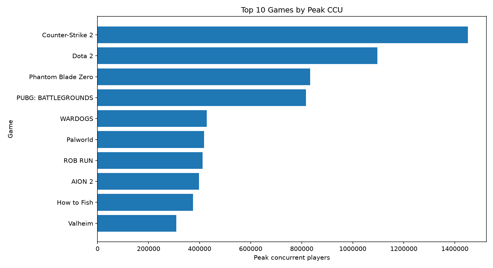

# GamePulse Analytics

GamePulse Analytics is a game data analytics project based on public Steam datasets. It explores game market characteristics, player activity, and game performance using Python, SQL, and data visualization.

## Project Overview

The project builds a reproducible data analytics pipeline from raw CSV datasets to processed data, a DuckDB database, SQL analysis, and visual reports.

The current analysis focuses on:

- Free-to-play and paid game market comparisons
- Review volume and positive review rates
- Peak concurrent player rankings
- Data quality and sampling limitations

## Data Sources

The project uses public Steam datasets from The Game Census:

- [Games Index](https://thegamecensus.com/data/games-index.csv)
- [Daily CCU Top 2000](https://thegamecensus.com/data/ccu-daily-top2000.csv)
- [Health Tiers](https://thegamecensus.com/data/health-tiers.csv)

Download the datasets and place them in `data/raw/` using their original filenames.

Raw datasets, processed CSV files, and the local database are not included in the repository.

## Data Pipeline

```text
Raw CSV datasets
      |
      v
Pandas preprocessing
      |
      v
Processed CSV datasets
      |
      v
DuckDB database
      |
      v
SQL analysis
      |
      v
Matplotlib visualization
```

## Analysis Results

### Free vs. Paid Games

The analyzed games-index dataset contains 85,041 games.

| Game Type | Game Count | Avg. Review Count | Positive Review Rate |
| --- | ---: | ---: | ---: |
| Paid | 68,948 | 2,043.10 | 87.30% |
| Free | 16,093 | 2,660.24 | 79.97% |

Key observations:

- Paid games account for approximately 81.1% of the dataset.
- Free games have a higher average review count in this dataset.
- Paid games have a higher aggregate positive review rate.

The positive review rate is calculated using total positive reviews divided by total reviews. These results describe the dataset and do not establish causality.

### Top 10 Games by Peak CCU



The ranking shows the highest observed concurrent player counts within the dataset's sampling window.

The analysis also considers observed days and average daily peak CCU to distinguish games with different sampling coverage.


## Data Coverage and Freshness

- The CCU analysis covers daily observations from August 6, 2026 to November 15, 2026 (102 calendar days).
- The CCU dataset contains daily Top 2000 observations, not complete player histories for all Steam games.
- Games Index and Health Tiers are analyzed as dataset snapshots. Their values may change in future downloads.
- The analysis reflects the downloaded datasets and is not a real-time Steam dashboard.
- Results may differ when the source datasets are updated or downloaded again.
## Data Limitations

- CCU refers to the maximum concurrent players recorded for a game on a given day. It is not DAU.
- The CCU dataset contains daily Top 2000 observations rather than complete histories for every Steam game.
- Games can have different numbers of observed days.
- Missing observations do not imply zero players.
- Review counts are not equivalent to sales, revenue, or player retention.

## Version

v1.0.0 — Initial release

The initial release includes data preprocessing, DuckDB integration, SQL analysis, and CCU visualization.